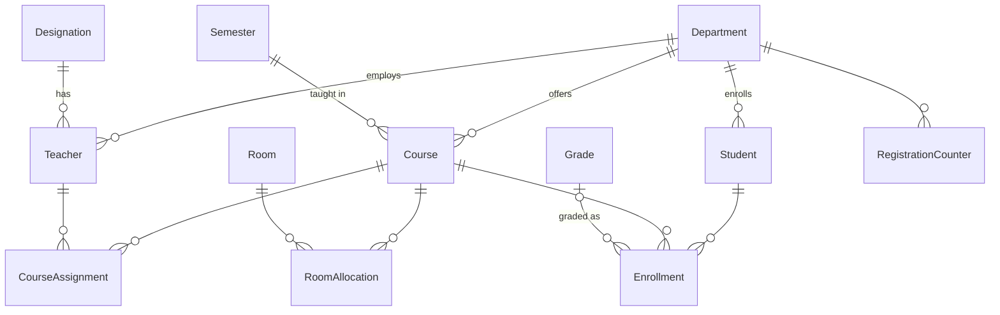

# Migration Plan: University Course & Result Management System → ASP.NET Core

Step-by-step plan to rebuild the 2017 ASP.NET MVC 5 app as an **ASP.NET Core 10 Web API +
Angular 22 SPA**. It follows the stack and conventions in `../SETUP.md` (the environment setup
in Part A of that file is a prerequisite). `SETUP.md` lives outside this repository, so every
snippet the plan needs from it is repeated here. Deviations from `SETUP.md` are called out where
they happen.

Original spec: `Specification of University Course and Result Management System (1).pdf`
(14 user stories). The spec is the source of truth. Where the 2017 code disagrees with it, the
new app follows the spec.

---

## 0. Decisions

| Area | Decision |
|---|---|
| Runtime | **.NET 10 LTS** (SDK 10.0.1xx, pinned in `global.json`) |
| API | ASP.NET Core **Minimal APIs**: route groups, `TypedResults`, feature folders |
| Validation | Built-in `AddValidation()` + DataAnnotations; business rules return Problem Details |
| Data | **EF Core 10** + SQL Server 2025 (Docker). New, clean schema built with code-first migrations |
| Auth | **ASP.NET Core Identity** + HttpOnly cookie for the SPA (same origin); roles **Admin / Staff / Teacher** |
| PDF | **QuestPDF** (Community license) replaces iTextSharp 5 (AGPL) |
| API docs | Built-in OpenAPI + Scalar UI; OpenAPI file also generated at build time for the TypeScript types |
| Observability | `ILogger` + OpenTelemetry (traces, metrics, logs over OTLP) → Aspire Dashboard container locally |
| Frontend | **Angular 22**: standalone, zoneless, OnPush, **Signal Forms** (stable in v22), `httpResource`, **Angular Material** |
| Tests | xUnit v3, `WebApplicationFactory`, Testcontainers (SQL Server), Respawn, Shouldly · Vitest · Playwright |
| Packaging | One container image: the API serves the built SPA from `wwwroot`. Built with `dotnet publish /t:PublishContainer` |
| CI | GitHub Actions + Dependabot + CodeQL |
| Deployment | **Decided later.** The plan ends with a production-ready image and CI. Options are in Appendix C |
| Git | Work on branch `migration/aspnet-core` in this repository. `master` keeps the 2017 code until the final PR |

**Deviations from `SETUP.md`** (each one is deliberate):

- **Surrogate `int` keys** plus unique indexes on natural keys (codes, emails, registration
  numbers). The Departments sample used `Code` as the primary key. With surrogate keys, foreign
  keys stay small and a code can be fixed without cascading updates.
- **Central Package Management with exact versions** instead of `10.0.*` floating versions, so
  builds are reproducible. Dependabot handles patch updates.
- **Signal Forms** instead of typed reactive forms. They became stable in Angular 22, and
  Angular Material supports them.

---

## 1. What the analysis of the 2017 code found

### 1.1 Legacy stack

| Item | Found | Replacement |
|---|---|---|
| Framework | ASP.NET MVC 5.2.2 on .NET Framework 4.5, `Global.asax`, `App_Start/*Config.cs` | ASP.NET Core 10 `Program.cs` |
| Data access | Raw ADO.NET through `Gateway/DatabaseGateway.cs`. Connection string hard-coded to `DESKTOP-OE85NNT\SQLEXPRESS` | EF Core 10 + configuration/user secrets |
| EF 6.1.1 | Referenced but used only by the unused Identity template | — |
| Auth | OWIN Identity 2.1 template code. `Web.config` has `<authentication mode="None" />`, and `App_Data/*.mdf` is only the template's LocalDB | ASP.NET Core Identity |
| PDF | iTextSharp 5.5.12 `HTMLWorker` (deprecated, AGPL) | QuestPDF |
| UI | Razor views, Bootstrap 3.3.7, jQuery 3.2.1 + jQuery Validation, a purchased HTML theme (`css/style.css`, `js/script.js`) | Angular 22 + Material |
| Bundling | `System.Web.Optimization` | Angular CLI (esbuild/Vite) |

### 1.2 The SQL dumps don't match the code

The dumps (`15-10-2017.sql`, `18-10-2017.sql`) use column names like `DEPT_CODE`, `NAME`,
`SEM_NO` and `DESIGNATION_NAME`. The C# code queries `DeptCode`, `CourseName`, `SemNo`,
`DesignationName`, `TeacherEmail`, `Valid`, `EnrollDate` and `GradeLetter`, none of which exist
in the dumps. The database the code last ran against was never exported. Other problems in the
dumps:

- No foreign keys at all.
- `TEACHER` has no primary key and **no email column**, although email must be unique.
- `SEMESTER`, `WEEKDAY` and `ROOM_SCHEDULE` have no primary keys. `ROOM_SCHEDULE` has no
  `Valid` column.
- Table name typo: `ENDROLLMENT`.
- Only lookup data is present: 8 departments, 6 designations, 12 grades, 22 rooms,
  8 semesters and 7 weekdays. There are no students, teachers, courses or results.

**Consequence:** there is **no data to migrate**. The new schema is designed from the spec and
the code's intent. The lookup rows from `18-10-2017.sql` (designations, grades, rooms and
semesters) become seed data, with the D- grade added (see 1.4). The 8 departments become optional
development sample data, because departments are user data that story 1 creates (see 2.3).

### 1.3 Security and robustness defects (fixed by design in the new app)

1. **SQL injection** through string concatenation in `CourseController.GetCoursesByDepartmentCode`,
   `TeacherController.AddTeacher / GetTeacherByDepartment / GeTeacherByTeacherId /
   GetCoursesByDepartmentCode / GetCourseByCourseCode / CourseAssignToTeacher`,
   `ClassRoomController.GetAllocationInfo / AllocateClassRoom / GetRoomScheduleByDepartment`,
   `StudentController.RegisterStudent / GetStudentByStudentRegNo / GetCoursesByDepartment*`,
   and `ResultController.GetCoursesByStudent / GetStudentByStudentRegNo / GetResultByStudent /
   SaveStudentResult / GenerateResultPDF`.
2. **Destructive actions on HTTP GET with no confirmation.** Just opening the
   *Unassign All Courses* or *Unallocate Class Room* menu item runs the update.
3. No CSRF protection and no server-side validation. Validation is only in jQuery.
4. One `SqlCommand` is shared across calls, so parameters pile up. Connections aren't disposed
   if an exception is thrown. Every query is synchronous.
5. The course assignment stores the teacher's **name** in `COURSE.FACULTY`. The teacher's
   remaining credit is computed from a value the **client posts**, and the two updates don't
   run in a transaction.
6. Duplicate actions: `SaveDepartment`/`newDepartment`, `SaveCourse`/`AddCourse` and
   `SaveTeacher`/`AddTeacher`.
7. `Views/Home/Index.cshtml` links to the Diagnostic Center app's `.aspx` pages (copy-paste
   leftover).

### 1.4 Gaps between the spec and the 2017 behavior (the new app follows the spec)

| # | Spec story | 2017 behavior | New behavior |
|---|---|---|---|
| 1 | Department code is 2–7 chars; code and name are unique | Length not enforced | Validated (400) + unique indexes (409) |
| 3 | Course code ≥ 5 chars; code **and name** unique; credit 0.5–5.0 | Only code uniqueness checked | All rules enforced |
| 4 | Teacher email valid + unique; credit ≥ 0 | Email column missing in dump; no checks | Enforced |
| 5 | Yes/No dialog when course credit > teacher's remaining credit | No dialog; assignment always goes through | API returns 409 `credit-overload`. UI asks Yes/No and resends with `allowOverload: true` |
| 7 | Reg. no. `<DEPT>-<YEAR>-XXX`, starting at 001 | `COUNT(*)` → the number is the count + 1, so it starts at 001, but two concurrent registrations get the same number | Counter row per (department, year), incremented atomically in the same transaction as the insert → 001, 002, … |
| 8 | No full or partial overlap **for a room** | Compares only against **one** earlier allocation of the **same course**. Room is ignored. `NoTimeOverlap` actually returns true when they *do* overlap | Rejects when another active allocation has the same room and day and `new.Start < existing.End && new.End > existing.Start`. Checked inside a serializable transaction |
| 9 | One row per course; "Not Scheduled Yet" | Prints "Not Schedule Yet" | One row per course with every slot listed; "Not Scheduled Yet" |
| 10 | Course dropdown shows course **names** | Shows codes | Shows "CODE – Name" |
| 11 | 13 grades incl. **D-** | 12 grades; D- missing | 13 grades, each with a grade point |
| 12 | PDF with name, reg. no., dept, email, results | Relies on `TempData` from an earlier AJAX call; university name hard-coded; CGPA counts ungraded courses as 0.00 and divides by zero when there are no courses | Stateless `GET /api/students/{id}/result.pdf`. CGPA uses graded courses only. University name comes from configuration |
| 13 | Confirm "Are you sure to unassign all courses?"; no deletes | Runs on GET, no dialog; teachers' remaining credit **not restored** | Confirm dialog. Assignments are soft-deactivated, and remaining credit is derived, so it restores automatically |
| 14 | Confirm "Are you sure to unallocate all classrooms info?"; no deletes | Runs on GET, no dialog | Confirm dialog + soft-deactivate |

---

## 2. Target architecture

### 2.1 Repository layout (on branch `migration/aspnet-core`)

```
University-Course-and-Result-Management-System/
├── .github/
│   ├── workflows/ci.yml
│   └── dependabot.yml
├── docs/
│   ├── MIGRATION_PLAN.md               # this file (moved here in Phase 0)
│   ├── spec.pdf                        # renamed copy of the spec
│   └── legacy-sql/                     # the two 2017 dumps, kept for reference
├── legacy/                             # 2017 MVC solution (git mv). Deleted in Phase 9
├── openapi/                            # University.Api.json, written by the API build, committed
├── src/
│   ├── University.Api/                 # ASP.NET Core 10 Minimal API
│   └── university-web/                 # Angular 22 SPA
├── tests/
│   ├── University.Api.UnitTests/
│   └── University.Api.IntegrationTests/
├── .editorconfig  .gitignore  .gitattributes
├── .env.example                        # MSSQL_SA_PASSWORD=...  (real .env is git-ignored)
├── compose.yaml                        # SQL Server 2025 + Aspire Dashboard
├── Directory.Build.props
├── Directory.Packages.props
├── dotnet-tools.json                   # dotnet-ef
├── global.json
├── README.md
└── University.slnx
```

### 2.2 API project structure (vertical feature folders)

```
src/University.Api/
├── Program.cs                         # composition root only; calls the extension methods below
├── Common/
│   ├── ServiceCollectionExtensions.cs # AddPersistence, AddAuth, AddApiDocs, AddObservability
│   ├── Errors/DbExceptionHandler.cs   # IExceptionHandler: unique violation → 409, concurrency → 409
│   ├── Security/Roles.cs  Policies.cs  AntiforgeryFilter.cs
│   └── Validation/                    # custom attributes (e.g. [NotDefault])
├── Data/
│   ├── UniversityDbContext.cs         # IdentityDbContext<ApplicationUser>
│   ├── Configurations/*.cs            # one IEntityTypeConfiguration<T> per entity
│   ├── Seed/LookupSeed.cs             # HasData lookup rows from 18-10-2017.sql (+ D-)
│   ├── Seed/SampleDataSeeder.cs       # Development only: the 8 departments from the dump
│   └── Migrations/
├── Auth/            AuthEndpoints.cs  UserAdminEndpoints.cs  ApplicationUser.cs  AdminSeeder.cs
├── Lookups/         LookupEndpoints.cs                  # semesters, designations, grades, rooms, days
├── Departments/     Department.cs  DepartmentDtos.cs  DepartmentEndpoints.cs
├── Courses/         Course.cs  CourseDtos.cs  CourseEndpoints.cs
├── Teachers/        Teacher.cs  TeacherDtos.cs  TeacherEndpoints.cs
├── CourseAssignments/ CourseAssignment.cs  …Endpoints.cs
├── Students/        Student.cs  RegistrationCounter.cs  RegistrationNumberGenerator.cs  StudentEndpoints.cs
├── Enrollments/     Enrollment.cs  EnrollmentEndpoints.cs
├── Results/         GpaCalculator.cs  ResultEndpoints.cs  ResultPdfDocument.cs (QuestPDF)
└── RoomAllocations/ Room.cs  RoomAllocation.cs  ScheduleRules.cs  RoomAllocationEndpoints.cs
```

Rules (from `SETUP.md`): entities are never returned from endpoints. Reads use `AsNoTracking()`
and project to DTOs. Bulk operations use `ExecuteUpdateAsync`. Domain rules live in small pure
classes (`ScheduleRules`, `RegistrationNumberGenerator`, `GpaCalculator`) so they can be unit
tested without a database. A single project is enough at this size, so there are no
Clean Architecture layers.

### 2.3 Data model



| Entity | Key columns and constraints |
|---|---|
| `Department` | `Id`, `Code` varchar(7) **unique**, `Name` nvarchar(100) **unique** |
| `Semester` | `Id`, `Number` tinyint 1–8 unique, `Name` ("1st"…"8th") |
| `Designation` | `Id`, `Name` unique |
| `Course` | `Id`, `Code` varchar(10) **unique** (≥ 5 chars), `Name` nvarchar(100) **unique**, `Credit` decimal(3,1) CHECK 0.5–5.0, `Description` nvarchar(500)?, `DepartmentId`, `SemesterId` |
| `Teacher` | `Id`, `Name`, `Address`, `Email` **unique**, `ContactNo`, `DesignationId`, `DepartmentId`, `CreditLimit` decimal(4,1) CHECK ≥ 0 |
| `CourseAssignment` | `Id`, `CourseId`, `TeacherId`, `AssignedAt`, `UnassignedAt?`, `IsActive`. **Filtered unique index** `(CourseId) WHERE IsActive = 1`, so the database itself prevents a course being assigned twice |
| `Room` | `Id`, `Number` varchar(10) unique |
| `RoomAllocation` | `Id`, `CourseId`, `RoomId`, `Day` (`DayOfWeek`, stored as string), `StartTime`/`EndTime` (`TimeOnly`) CHECK End > Start, `IsActive`, `AllocatedAt`, `DeallocatedAt?`. Index on `(RoomId, Day, IsActive)` |
| `Student` | `Id`, `RegistrationNo` varchar(20) **unique**, `Name`, `Email` **unique**, `ContactNo`, `RegistrationDate` (`DateOnly`), `Address`, `DepartmentId` |
| `RegistrationCounter` | PK `(DepartmentId, Year)`, `LastNumber`. Incremented with one atomic `UPDATE`, so it needs no concurrency token (see 4.7) |
| `Enrollment` | `Id`, `StudentId`, `CourseId`, `EnrolledOn` (`DateOnly`), `GradeId?`, `GradedAt?`. **Unique** `(StudentId, CourseId)` |
| `Grade` | `Id`, `Letter` varchar(2) unique, `Point` decimal(3,2), `SortOrder` |
| Identity tables | `AspNetUsers`, `AspNetRoles`, … (same `DbContext`) |

**Derived values (never stored):**

- *Remaining credit* = `CreditLimit − SUM(active assignments' course credit)`. It can go
  negative when an overload was confirmed.
- *Assigned To* = the teacher on the active assignment, or `null` → "Not Assigned Yet".

**Seed data (`HasData`, in migrations):** 6 designations (fix the typo "Assosiate" → "Associate"),
22 rooms, 8 semesters and 13 grades. Departments are **not** seeded by migrations. They are user
data, and seeded rows would collide with the tests and with story 1. For local development,
`SampleDataSeeder` inserts the 8 departments from the dump when `Seed:SampleData` is `true`, with
codes upper-cased like any other department (`B.Pharm` → `B.PHARM`, see 4.2). Grade points:
A+ 4.00, A 4.00, A- 3.70, B+ 3.30, B 3.00, B- 2.70, C+ 2.30, C 2.00, C- 1.70, D+ 1.30,
D 1.00, **D- 0.70** (assumed, see Appendix D), F 0.00.

### 2.4 Security model

| Role | Can do |
|---|---|
| **Admin** | Everything, plus user management, *Unassign All Courses* and *Unallocate All Classrooms* |
| **Staff** (academic office) | Departments, courses, teachers, course assignment, room allocation, student registration, enrollment |
| **Teacher** | Save student results; read-only views |
| Any signed-in user | Read-only views: departments, course statistics, class schedule, results, PDF |

- There is no public registration. Admins create users. The first Admin is seeded at startup
  from configuration (user secrets locally, environment variables in deployment), in every
  environment, and only when `Seed:AdminEmail` is set and no Admin exists yet.
- The cookie is `HttpOnly` with `SameSite=Strict`, and always `Secure` outside Development. TLS
  ends at the reverse proxy, so the app reads the forwarded headers (see 8.1). For the API, the
  cookie events return **401/403** instead of redirecting.
- **Fallback authorization policy = authenticated user.** Anonymous endpoints opt out
  explicitly: login, health, OpenAPI in development, static SPA files and the SPA fallback.
- Antiforgery as defense in depth: the server issues an `XSRF-TOKEN` cookie, Angular's
  `HttpClient` sends it back as an `X-XSRF-TOKEN` header, and an endpoint filter validates it
  on POST/PUT/DELETE.
- Login is rate limited (`AddRateLimiter`, fixed window per client IP, which also depends on the
  forwarded headers). Identity lockout is on: 5 attempts, then a 15-minute lockout.

### 2.5 Endpoint catalogue

All routes are under `/api`. Responses are DTOs. Errors are RFC 7807 Problem Details.

| Spec # | Method & route | Policy | Notes |
|---|---|---|---|
| — | `POST /auth/login`, `POST /auth/logout`, `GET /auth/me`, `GET /auth/xsrf` | anon / user | `me` returns name + roles for the SPA |
| — | `GET/POST /admin/users`, `PUT /admin/users/{id}/roles` | Admin | |
| — | `GET /lookups/semesters` · `designations` · `grades` · `rooms` · `days` | user | Static lists; the SPA loads each one once |
| 1, 2 | `GET /departments`, `POST /departments` | user / Staff | 409 on duplicate code or name |
| 3 | `GET /courses?departmentId=`, `POST /courses` | user / Staff | |
| 4 | `GET /teachers?departmentId=`, `GET /teachers/{id}`, `POST /teachers` | user / Staff | `GET {id}` includes `creditLimit`, `remainingCredit` |
| 5 | `POST /course-assignments` `{courseId, teacherId, allowOverload}` | Staff | 409 `already-assigned`, 409 `credit-overload` (with `remainingCredit`, `courseCredit` extensions) |
| 13 | `POST /course-assignments/unassign-all` | Admin | Soft-deactivates; returns the count |
| 6 | `GET /departments/{id}/course-statistics` | user | code, name, semester, `assignedTo?` |
| 7 | `POST /students`, `GET /students`, `GET /students/{id}` | Staff / user | 201 with the generated `registrationNo` |
| 8 | `POST /room-allocations` `{courseId, roomId, day, startTime, endTime}` | Staff | 409 `room-overlap` names the conflicting course and slot |
| 14 | `POST /room-allocations/unallocate-all` | Admin | Soft-deactivates |
| 9 | `GET /departments/{id}/class-schedule` | user | One row per course with a `slots[]` array |
| 10 | `GET /students/{id}/available-courses`, `POST /enrollments` | Staff | Only the student's department; 409 if already enrolled |
| 11 | `GET /students/{id}/enrollments`, `PUT /enrollments/{id}/grade` `{gradeId}` | Teacher+ | Only enrolled courses, by construction |
| 12 | `GET /students/{id}/result`, `GET /students/{id}/result.pdf` | user | PDF via QuestPDF |
| — | `GET /health/live`, `GET /health/ready` | anon | `ready` includes the DbContext check |

---

## Phase 0 — Prepare the repository

**0.1 Check prerequisites.**

```bash
dotnet --list-sdks        # 10.0.1xx
node --version            # v24.x
ng version                # Angular CLI 22.x
docker compose version
gh auth status
```

Doing the `SETUP.md` Part B sample first is recommended (it isn't in this folder yet). It's the
same pattern at a smaller scale.

**0.2 Create the branch.**

```bash
cd ~/Development-Projects/ASP-dot-NET-CORE-Projects/University-Course-and-Result-Management-System
git switch master && git pull
git switch -c migration/aspnet-core
```

**0.3 Move the legacy code and clean the repository.**

```bash
mkdir -p legacy docs/legacy-sql
git mv UniversityCourseAndResultManagementSystemApp legacy/
git mv 15-10-2017.sql 18-10-2017.sql docs/legacy-sql/
git mv "Specification of University Course and Result Management System (1).pdf" docs/spec.pdf
mv MIGRATION_PLAN.md docs/            # untracked so far, so plain mv; it's added with the next commit
git rm Tasks.txt
# Untrack build output and user files if they were ever committed:
git ls-files legacy | grep -E '/(bin|obj|packages)/|\.suo$|\.user$|\.mdf$|\.ldf$' | xargs -r git rm --cached
```

**0.4 Create the solution skeleton.**

```bash
dotnet new globaljson --sdk-version 10.0.100 --roll-forward latestFeature
dotnet new gitignore
dotnet new editorconfig
dotnet new sln -n University                 # → University.slnx
dotnet new tool-manifest && dotnet tool install dotnet-ef --version "10.*"
```

Add `[**/Migrations/*.cs]` → `generated_code = true` to `.editorconfig` so generated migrations
don't trip the analyzers. Add `* text=auto eol=lf` to `.gitattributes`.

`Directory.Build.props`:

```xml
<Project>
  <PropertyGroup>
    <TargetFramework>net10.0</TargetFramework>
    <Nullable>enable</Nullable>
    <ImplicitUsings>enable</ImplicitUsings>
    <TreatWarningsAsErrors>true</TreatWarningsAsErrors>
    <AnalysisLevel>latest-recommended</AnalysisLevel>
    <EnforceCodeStyleInBuild>true</EnforceCodeStyleInBuild>
    <NuGetAuditMode>all</NuGetAuditMode>
    <WarningsNotAsErrors>NU1901;NU1902;NU1903;NU1904</WarningsNotAsErrors>
  </PropertyGroup>
</Project>
```

The NuGet audit warnings (`NU1901`–`NU1904`) stay warnings. Otherwise a newly published advisory
for any transitive package would fail every build until a fix ships.

`Directory.Packages.props`. Replace each version with the latest stable patch shown by
`dotnet package search <id> --exact-match`, keeping Microsoft packages on **10.0.x**:

```xml
<Project>
  <PropertyGroup>
    <ManagePackageVersionsCentrally>true</ManagePackageVersionsCentrally>
  </PropertyGroup>
  <ItemGroup Label="API">
    <PackageVersion Include="Microsoft.AspNetCore.OpenApi" Version="10.0.0" />
    <PackageVersion Include="Microsoft.Extensions.ApiDescription.Server" Version="10.0.0" />
    <PackageVersion Include="Microsoft.AspNetCore.Identity.EntityFrameworkCore" Version="10.0.0" />
    <PackageVersion Include="Microsoft.EntityFrameworkCore.SqlServer" Version="10.0.0" />
    <PackageVersion Include="Microsoft.EntityFrameworkCore.Design" Version="10.0.0" />
    <PackageVersion Include="Microsoft.Extensions.Diagnostics.HealthChecks.EntityFrameworkCore" Version="10.0.0" />
    <PackageVersion Include="Scalar.AspNetCore" Version="x.y.z" />
    <PackageVersion Include="QuestPDF" Version="2026.x.y" />
    <PackageVersion Include="OpenTelemetry.Extensions.Hosting" Version="x.y.z" />
    <PackageVersion Include="OpenTelemetry.Instrumentation.AspNetCore" Version="x.y.z" />
    <PackageVersion Include="OpenTelemetry.Instrumentation.Http" Version="x.y.z" />
    <PackageVersion Include="OpenTelemetry.Instrumentation.SqlClient" Version="x.y.z" />
    <PackageVersion Include="OpenTelemetry.Exporter.OpenTelemetryProtocol" Version="x.y.z" />
  </ItemGroup>
  <ItemGroup Label="Tests">
    <PackageVersion Include="xunit.v3" Version="x.y.z" />
    <PackageVersion Include="xunit.runner.visualstudio" Version="x.y.z" />
    <PackageVersion Include="Microsoft.NET.Test.Sdk" Version="x.y.z" />
    <PackageVersion Include="Microsoft.AspNetCore.Mvc.Testing" Version="10.0.0" />
    <PackageVersion Include="Testcontainers.MsSql" Version="x.y.z" />
    <PackageVersion Include="Respawn" Version="x.y.z" />
    <PackageVersion Include="Shouldly" Version="x.y.z" />
  </ItemGroup>
</Project>
```

> Use Shouldly or plain `Assert` rather than FluentAssertions 8, which requires a paid license
> for commercial use.

**0.5 Docker Compose.** Create `.env` (git-ignored) with `MSSQL_SA_PASSWORD=<strong password>`,
and commit an `.env.example` with a placeholder value. `compose.yaml` runs SQL Server and the
Aspire Dashboard for telemetry:

```yaml
services:
  sqlserver:
    image: mcr.microsoft.com/mssql/server:2025-latest
    container_name: university-sql
    environment:
      ACCEPT_EULA: "Y"
      MSSQL_PID: "Developer"
      MSSQL_SA_PASSWORD: "${MSSQL_SA_PASSWORD:?Set MSSQL_SA_PASSWORD in .env}"
    ports:
      - "1433:1433"
    volumes:
      - university-sql-data:/var/opt/mssql
    healthcheck:
      test: ["CMD-SHELL", "/opt/mssql-tools18/bin/sqlcmd -S localhost -U sa -P \"$${MSSQL_SA_PASSWORD}\" -C -Q 'SELECT 1' || exit 1"]
      interval: 10s
      timeout: 5s
      retries: 10
      start_period: 20s
    restart: unless-stopped

  aspire-dashboard:
    image: mcr.microsoft.com/dotnet/aspire-dashboard:latest
    ports: ["18888:18888", "4317:18889"]   # UI on :18888, OTLP gRPC on :4317
    environment:
      DOTNET_DASHBOARD_UNSECURED_ALLOW_ANONYMOUS: "true"   # local only

volumes:
  university-sql-data:
```

Commit: `chore: move 2017 app to legacy/, add .NET 10 solution skeleton`.

**Done when:** `dotnet build` succeeds on the empty solution, `docker compose up -d` shows
`university-sql` as healthy, and `git status` shows no `.env`, `bin/` or `obj/`.

---

## Phase 1 — API foundation

**1.1 Create the project.**

```bash
dotnet new webapi -o src/University.Api
dotnet sln add src/University.Api
cd src/University.Api
dotnet add package Microsoft.AspNetCore.OpenApi           # (repeat for each API package; CPM supplies versions)
dotnet user-secrets init
dotnet user-secrets set "ConnectionStrings:University" \
  'Server=localhost,1433;Database=University;User Id=sa;Password=<from .env>;TrustServerCertificate=True;Encrypt=True'
dotnet user-secrets set "Seed:AdminEmail" 'admin@university.local'
dotnet user-secrets set "Seed:AdminPassword" '<strong password>'
```

Delete the weather sample and `University.Api.http`. Set the `http` profile in
`launchSettings.json` to `http://localhost:5080`.

**1.2 `Program.cs` composition** (keep it short; each `Add*` lives in `Common/`):

```csharp
var builder = WebApplication.CreateBuilder(args);

builder.Services.AddPersistence(builder.Configuration);   // DbContext + SQL retry strategy
builder.Services.AddAuth(builder.Environment);            // Identity, cookie, policies, antiforgery, rate limiter
builder.Services.AddApiDocs();                            // AddOpenApi
builder.Services.AddObservability(builder.Configuration); // OpenTelemetry
builder.Services.AddValidation();
builder.Services.AddProblemDetails();
builder.Services.AddExceptionHandler<DbExceptionHandler>();
builder.Services.AddSingleton(TimeProvider.System);
builder.Services.AddHealthChecks().AddDbContextCheck<UniversityDbContext>(tags: ["ready"]);

var app = builder.Build();

app.UseExceptionHandler();
app.UseStatusCodePages();
app.UseRateLimiter();
app.UseAuthentication();
app.UseAuthorization();

if (app.Environment.IsDevelopment())
{
    app.MapOpenApi().AllowAnonymous();
    app.MapScalarApiReference().AllowAnonymous();
    await app.SeedSampleDataAsync();                      // the 8 departments, when Seed:SampleData is true
}

await app.SeedAdminAsync();   // every environment; does nothing unless Seed:AdminEmail is set and no Admin exists

app.MapHealthChecks("/health/live", new() { Predicate = _ => false }).AllowAnonymous();
app.MapHealthChecks("/health/ready", new() { Predicate = c => c.Tags.Contains("ready") }).AllowAnonymous();

var api = app.MapGroup("/api").AddEndpointFilter<AntiforgeryFilter>();
api.MapAuthEndpoints();
api.MapLookupEndpoints();
api.MapDepartmentEndpoints();
// … one Map<Feature>Endpoints() per feature

app.Run();

public partial class Program;   // for WebApplicationFactory in integration tests
```

**1.3 Persistence.** Register `UseSqlServer(cs, o => o.EnableRetryOnFailure())`. Because of the
retry strategy, any explicit transaction must run inside
`db.Database.CreateExecutionStrategy().ExecuteAsync(...)`.

**1.4 `DbExceptionHandler`** (`IExceptionHandler`). Map `DbUpdateException` with SQL error
**2601/2627** (unique violation) → 409 Problem Details, `DbUpdateConcurrencyException` → 409,
and everything else → 500 with no internal details. Endpoints still check for duplicates first
so they can return a friendly message. The handler covers races.

**1.5 Build-time OpenAPI file** (consumed by Angular in Phase 5). In the `.csproj`:

```xml
<PropertyGroup>
  <OpenApiDocumentsDirectory>$(MSBuildProjectDirectory)/../../openapi</OpenApiDocumentsDirectory>
</PropertyGroup>
```

The file goes to the repository-level `openapi/` folder, not into `src/university-web/`, which
doesn't exist until Phase 5. Commit `openapi/University.Api.json`. CI fails when the committed
file is out of date (see 8.5).

Gotcha: the generator runs the app's entry point. Skip the connection-string check and both
seeders when `Assembly.GetEntryAssembly()?.GetName().Name == "GetDocument.Insider"`.

**1.6 Observability.** `AddOpenTelemetry().WithTracing(...)/.WithMetrics(...)` with the
ASP.NET Core, HttpClient and SqlClient instrumentation, plus `.UseOtlpExporter()`. Point
`OTEL_EXPORTER_OTLP_ENDPOINT` at `http://localhost:4317` in `launchSettings.json`.

**1.7 CI from the first commit.** Add `.github/workflows/ci.yml` with the `api` job from 8.5
(restore, build, test) now, so every later commit on the branch is checked. The `web` job joins
in Phase 5 and the `e2e` job in Phase 7.

**Done when:** `dotnet watch` starts, `/health/live` → Healthy, `/scalar` loads, the build
writes `openapi/University.Api.json`, and the CI `api` job is green.

---

## Phase 2 — Data model and migrations

**2.1** Create the entities from §2.3, one file per entity in its feature folder. Use
`required` members and private setters where an invariant matters (e.g. `RoomAllocation`
validates `EndTime > StartTime` in its constructor).

**2.2** Create one `IEntityTypeConfiguration<T>` per entity in `Data/Configurations`: lengths,
`decimal` precision, unique indexes, check constraints (`ToTable(t => t.HasCheckConstraint(...))`),
the filtered unique index on `CourseAssignment` (`.HasFilter("[IsActive] = 1")`), and
`DeleteBehavior.Restrict` on every FK (nothing is ever deleted).

**2.3** `UniversityDbContext : IdentityDbContext<ApplicationUser>`. Call
`base.OnModelCreating(builder)` first, then `ApplyConfigurationsFromAssembly(...)`. Add one
convention:

```csharp
protected override void ConfigureConventions(ModelConfigurationBuilder b)
    => b.Properties<DayOfWeek>().HaveConversion<string>().HaveMaxLength(9);
```

**2.4** Seed lookups with `HasData` in `Data/Seed/LookupSeed.cs`, with fixed IDs so the seed is
stable across migrations. The rows come from `docs/legacy-sql/18-10-2017.sql` plus D-
(see §2.3). Departments are not part of this seed. Roles (`Admin`, `Staff`, `Teacher`) are seeded
the same way, and each one needs a fixed `Id`, `NormalizedName` and `ConcurrencyStamp`.
`IdentityRole` otherwise generates a new stamp on every model build, and EF Core then fails
`database update` with a pending-model-changes error. The admin user is seeded at startup by
`AdminSeeder` from configuration, not in a migration, so no password hash is committed.

**2.5** Create and review the first migration:

```bash
dotnet ef migrations add InitialCreate --project src/University.Api --output-dir Data/Migrations
dotnet ef migrations script --project src/University.Api -o artifacts/InitialCreate.sql   # read it
dotnet ef database update --project src/University.Api
```

Check the generated SQL for the filtered index, the check constraints and the `Restrict` FKs.

**2.6 Test projects and fixture.** Phases 3 and 4 are finished only when their integration tests
pass, so the test infrastructure is built here. Create `tests/University.Api.UnitTests` and
`tests/University.Api.IntegrationTests` (xUnit v3) and add them to the solution. In the
integration project, add a `WebApplicationFactory<Program>` subclass and an assembly fixture that
starts one `MsSqlContainer` (`mcr.microsoft.com/mssql/server:2025-latest`) per test run and
applies the migrations once. `Respawn` resets the data between tests but keeps the lookup tables,
the roles and `__EFMigrationsHistory`.

**Done when:** the database exists with every table, constraint and seed row,
`SELECT * FROM Grades` returns 13 rows, and a first integration test gets 200 from
`/health/ready` against the container, locally and in CI.

---

## Phase 3 — Authentication and authorization

**3.1 Identity and cookie** (`Common/ServiceCollectionExtensions.AddAuth`):

```csharp
services.AddAuthentication(IdentityConstants.ApplicationScheme).AddIdentityCookies();
services.AddIdentityCore<ApplicationUser>(o =>
    {
        o.User.RequireUniqueEmail = true;
        o.Password.RequiredLength = 10;
        o.Lockout.MaxFailedAccessAttempts = 5;
        o.Lockout.DefaultLockoutTimeSpan = TimeSpan.FromMinutes(15);
    })
    .AddRoles<IdentityRole>()
    .AddEntityFrameworkStores<UniversityDbContext>()
    .AddSignInManager();

services.ConfigureApplicationCookie(o =>
{
    o.Cookie.Name = "university.auth";
    o.Cookie.HttpOnly = true;
    o.Cookie.SameSite = SameSiteMode.Strict;
    o.Cookie.SecurePolicy = env.IsDevelopment()     // env: the IHostEnvironment passed to AddAuth
        ? CookieSecurePolicy.SameAsRequest          // plain HTTP behind the Angular dev proxy
        : CookieSecurePolicy.Always;                // HTTPS at the proxy, seen through forwarded headers (8.1)
    o.ExpireTimeSpan = TimeSpan.FromHours(8);
    o.SlidingExpiration = true;
    o.Events.OnRedirectToLogin = ctx => { ctx.Response.StatusCode = 401; return Task.CompletedTask; };
    o.Events.OnRedirectToAccessDenied = ctx => { ctx.Response.StatusCode = 403; return Task.CompletedTask; };
});
```

**3.2 Policies:**

```csharp
services.AddAuthorizationBuilder()
    .SetFallbackPolicy(new AuthorizationPolicyBuilder().RequireAuthenticatedUser().Build())
    .AddPolicy(Policies.Admin,   p => p.RequireRole(Roles.Admin))
    .AddPolicy(Policies.Staff,   p => p.RequireRole(Roles.Admin, Roles.Staff))
    .AddPolicy(Policies.Grading, p => p.RequireRole(Roles.Admin, Roles.Staff, Roles.Teacher));
```

Apply them per endpoint or per route group, e.g.
`group.MapPost("/", Create).RequireAuthorization(Policies.Staff)`.

**3.3 Auth endpoints.** Write these by hand with `SignInManager.PasswordSignInAsync` instead of
using `MapIdentityApi`, because that exposes a public `/register`:

- `POST /api/auth/login`: `[AllowAnonymous]`, rate limited.
- `POST /api/auth/logout`
- `GET /api/auth/me`: `{ email, name, roles[] }`, or 401.
- `GET /api/auth/xsrf`: calls `IAntiforgery.GetAndStoreTokens` and writes the request token to
  a non-HttpOnly `XSRF-TOKEN` cookie. The SPA calls it on startup and again after login,
  because the token is bound to the user.

**3.4 Antiforgery filter.** `services.AddAntiforgery(o => o.HeaderName = "X-XSRF-TOKEN")`.
`AntiforgeryFilter` calls `await antiforgery.ValidateRequestAsync(ctx.HttpContext)` for
non-GET/HEAD requests, except `login`, and returns 400 Problem Details when validation fails.

**3.5 User administration** (Admin): list users, create a user with an initial password and
roles, change roles, lock or unlock.

**3.6 Test helper.** Add an authenticated `HttpClient` helper per role to the integration tests.
It creates the user, logs in, reads the `XSRF-TOKEN` cookie and sets the `X-XSRF-TOKEN` header.
Every feature test in Phase 4 uses it.

**Done when:** integration tests prove that anonymous calls get 401, a Staff user calling
`unassign-all` gets 403, a POST without the XSRF header gets 400, and the sixth bad password
locks the account.

---

## Phase 4 — Feature endpoints (in dependency order)

For each feature: entity → DTOs (`sealed record`, DataAnnotations on request types) →
endpoints (`TypedResults`, `CancellationToken` everywhere) → `.http` requests → integration
tests. Commit after each feature, e.g. `feat(courses): save course with validation`.

**4.1 Lookups.** One group with five GETs. There is no server-side caching: ASP.NET Core's output
cache skips authenticated requests by default, and these lists are tiny. The SPA loads each list
once instead (see 5.5). Days are returned Saturday-first, matching the 2017 `WEEKDAY` order.

**4.2 Departments (spec 1, 2).** Request: `[Required, StringLength(7, MinimumLength = 2)] Code`,
`[Required, StringLength(100)] Name`. Trim the input and upper-case the code. Return 409 if the
code or name exists. `GET` is ordered by code.

**4.3 Courses (spec 3).** `[StringLength(10, MinimumLength = 5)] Code`, a unique `Name`,
`[Range(0.5, 5.0)] Credit`, and `DepartmentId`/`SemesterId`, which must exist (otherwise 400
with a field error).

**4.4 Teachers (spec 4).** `[EmailAddress] Email` (unique, compared case-insensitively),
`[Range(0, 100)] CreditLimit`, valid `DesignationId` and `DepartmentId`. `GET /teachers/{id}`
returns `creditLimit` and `remainingCredit`, computed in the query.

**4.5 Course assignment (spec 5, 13).**

```csharp
// inside CreateExecutionStrategy().ExecuteAsync(...) + a transaction
var course  = await db.Courses.SingleAsync(c => c.Id == req.CourseId, ct);
// UPDLOCK: parallel assignments to the same teacher wait here, so the credit check can't be raced
var teacher = await db.Teachers
    .FromSql($"SELECT * FROM Teachers WITH (UPDLOCK) WHERE Id = {req.TeacherId}")
    .SingleAsync(ct);
if (course.DepartmentId != teacher.DepartmentId) return Problem400("Teacher and course must be in the same department.");
if (await db.CourseAssignments.AnyAsync(a => a.CourseId == course.Id && a.IsActive, ct))
    return TypedResults.Problem(title: "Course is already assigned.", statusCode: 409, type: Problems.AlreadyAssigned);

var used = await db.CourseAssignments.Where(a => a.TeacherId == teacher.Id && a.IsActive)
                                     .SumAsync(a => (decimal?)a.Course.Credit, ct) ?? 0m;
var remaining = teacher.CreditLimit - used;
if (course.Credit > remaining && !req.AllowOverload)
    return TypedResults.Problem(
        title: "Course credit exceeds the teacher's remaining credit.",
        statusCode: 409, type: Problems.CreditOverload,
        extensions: new Dictionary<string, object?> { ["remainingCredit"] = remaining, ["courseCredit"] = course.Credit });

db.CourseAssignments.Add(new CourseAssignment(course.Id, teacher.Id, time.GetUtcNow()));
await db.SaveChangesAsync(ct);   // the filtered unique index protects against a parallel assignment
```

`unassign-all`:
`db.CourseAssignments.Where(a => a.IsActive).ExecuteUpdateAsync(s => s.SetProperty(a => a.IsActive, false).SetProperty(a => a.UnassignedAt, now), ct)`.
Remaining credits restore automatically because they're derived.

**4.6 Course statistics (spec 6).** A single projection query with a left join to the active
assignment. Return `assignedTo = null`, and the UI renders "Not Assigned Yet".

**4.7 Student registration (spec 7).** `[EmailAddress]` unique, `RegistrationDate` (defaults
to today via `TimeProvider`). `RegistrationNumberGenerator` takes the next number with one atomic
statement, inside the same transaction as the student insert:

```csharp
var next = (await db.Database.SqlQuery<int>($"""
        UPDATE RegistrationCounters SET LastNumber = LastNumber + 1
        OUTPUT inserted.LastNumber AS [Value]
        WHERE DepartmentId = {dept.Id} AND [Year] = {year}
        """).ToListAsync(ct)).SingleOrDefault();   // 0 → no counter row for this department and year yet
```

The row lock makes parallel registrations queue, so numbers are never duplicated and nothing has
to be retried. When no row was updated, insert the counter with `LastNumber = 1`. If that insert
hits a primary-key violation because a parallel request created the row first, run the update
again. If the student insert then fails (a duplicate email, for example), the transaction rolls
the counter back, so no number is skipped. Format as `$"{dept.Code}-{year}-{n:D3}"`. The unique
index on `RegistrationNo` is the backstop. Return 201 with the full student DTO, including
`registrationNo`.

**4.8 Room allocation (spec 8, 14).** The pure rule goes in `ScheduleRules`:

```csharp
public static bool Overlaps(TimeOnly aStart, TimeOnly aEnd, TimeOnly bStart, TimeOnly bEnd)
    => aStart < bEnd && bStart < aEnd;   // covers partial, full and containment; touching edges are allowed
```

The endpoint runs in a **serializable** transaction, inside the execution strategy:

```csharp
var clash = await db.RoomAllocations
    .Where(a => a.IsActive && a.RoomId == req.RoomId && a.Day == req.Day
             && req.StartTime < a.EndTime && a.StartTime < req.EndTime)
    .Select(a => new { a.Course.Code, a.StartTime, a.EndTime })
    .FirstOrDefaultAsync(ct);
if (clash is not null) return TypedResults.Problem(title: $"Room is booked for {clash.Code} {clash.StartTime:t}–{clash.EndTime:t}.", statusCode: 409, type: Problems.RoomOverlap);
```

Two parallel allocations for the same room and day can deadlock under serializable isolation.
The request that loses must end as a retry or a 409, never a 500 (7.2 tests this).

`unallocate-all` uses `ExecuteUpdateAsync`, like 4.5.

**4.9 Class schedule (spec 9).** Query the department's courses with their active allocations
(`Include` + `AsSplitQuery`, or a projection). Return
`{ code, name, slots: [{ room, day, start, end }] }`. The UI formats it as
"R. No: 101, Sat, 10:00 AM – 11:30 AM" per slot, or "Not Scheduled Yet". There is one row per
course by construction.

**4.10 Enrollment (spec 10).** `available-courses` returns the student's department courses
that the student isn't enrolled in yet. `POST /enrollments` validates that the course is in the
student's department and returns 409 if it's a duplicate (the unique index is the backstop).

**4.11 Save result (spec 11).** `PUT /enrollments/{id}/grade` requires an existing enrollment,
so a result can only be saved for an enrolled course. Re-grading overwrites the grade and sets
`GradedAt`.

**4.12 View result + PDF (spec 12).** `GpaCalculator.Cgpa(IEnumerable<(decimal credit, decimal? point)>)`
skips ungraded courses and returns `null` when nothing is graded. The PDF endpoint builds a
`ResultPdfDocument : IDocument` (QuestPDF) with a header (university name from configuration
`University:Name`), the student block (name, reg. no., department, email), a results table
(code, title, credit, grade, point) and a summary (graded credits, CGPA, generation date).
Return `TypedResults.File(bytes, "application/pdf", $"{regNo}-result.pdf")`. Set
`QuestPDF.Settings.License = LicenseType.Community` at startup. Register a bundled TTF font
with `FontManager.RegisterFont`, so the output looks the same on Linux containers that have
no fonts installed.

**Done when:** every row of the §2.5 catalogue works in Scalar and in `University.Api.http`,
and each feature has integration tests for the success path and for every 400/401/403/404/409
case.

---

## Phase 5 — Angular foundation

**5.1 Create the app.**

```bash
cd src
ng new university-web --routing --style=scss --ssr=false --skip-git
cd university-web
ng add @angular/material                 # pick a theme; enable typography
ng add @angular-eslint/schematics
npm i -D prettier openapi-typescript @playwright/test
npx playwright install --with-deps chromium
ng config projects.university-web.architect.serve.options.proxyConfig proxy.conf.json
```

`proxy.conf.json` sends `/api` calls to the API. The browser sees one origin, so no CORS is
needed and the cookie flows:

```json
{
  "/api": {
    "target": "http://localhost:5080",
    "secure": false
  }
}
```

**5.2 Typed API contracts.** Add the script
`"api:types": "openapi-typescript ../../openapi/University.Api.json -o src/app/core/api/schema.d.ts"`.
Services use these generated types, so a DTO change in C# breaks the Angular build instead of
failing at runtime. That only holds while the generated files are current, so commit
`schema.d.ts` next to the OpenAPI file, and let CI regenerate both and fail on any difference
(see 8.5). Add the CI `web` job now.

**5.3 Folder layout.**

```
src/app/
├── app.config.ts  app.routes.ts  app.ts
├── core/
│   ├── api/        schema.d.ts (generated), lookup.service.ts
│   ├── auth/       auth.service.ts (signal: currentUser), auth.guard.ts (canMatch by role), login.page.ts
│   ├── http/       problem-details.interceptor.ts (→ snackbar), unauthorized.interceptor.ts (401 → /login)
│   └── layout/     shell.component.ts (Material toolbar + sidenav with the spec's menu)
├── shared/
│   ├── confirm-dialog/  confirm-dialog.component.ts + confirm.service.ts
│   └── pipes/           schedule-slot.pipe.ts, not-assigned.pipe.ts
└── features/
    ├── departments/  courses/  teachers/  course-assignments/
    ├── students/     enrollments/  results/  room-allocations/  admin/
```

**5.4 `app.config.ts`:**

```ts
export const appConfig: ApplicationConfig = {
  providers: [
    provideBrowserGlobalErrorListeners(),
    provideRouter(routes, withComponentInputBinding()),
    provideHttpClient(
      withInterceptors([unauthorizedInterceptor, problemDetailsInterceptor]),
      withXsrfConfiguration({ cookieName: 'XSRF-TOKEN', headerName: 'X-XSRF-TOKEN' }),
    ),
    provideAppInitializer(() => inject(AuthService).init()),   // GET /api/auth/xsrf + /api/auth/me
  ],
};
```

**5.5 Patterns used by every feature:**

- Reads use `httpResource()`, e.g.
  `departments = httpResource<DepartmentDto[]>(() => '/api/departments')`. Dependent dropdowns
  (department → teachers/courses) use a resource whose URL function reads the selected
  department signal.
- The five lookup lists (semesters, designations, grades, rooms, days) live in one root-provided
  `LookupService`. Its resources load once and every page shares them, which replaces
  server-side caching.
- Writes go through a feature service (`inject(HttpClient)`) and return observables.
- Forms use Signal Forms (`form()` with schema validators mirroring the server rules,
  `[formField]` on Material inputs). The server is still the authority. Map Problem Details
  `errors` onto the matching fields.
- Every route is lazy-loaded (`loadComponent`) and guarded by role. Menu items are hidden when
  the user lacks the role.

**Done when:** login and logout work against the API, the shell shows the menu for the
signed-in role, and a 401 redirects to `/login`.

---

## Phase 6 — Angular feature pages

| Legacy view (`legacy/…/Views`) | Angular route | Component highlights | Role |
|---|---|---|---|
| `Department/SaveDepartment` | `/departments/new` | Code + name form; 409 shown inline | Staff |
| `Department/ViewDepartment` | `/departments` | `mat-table` | any |
| `Course/SaveCourse` | `/courses/new` | Department + semester selects from lookups; credit with step 0.5 | Staff |
| `Teacher/SaveTeacher` | `/teachers/new` | Email validation; designation select; credit ≥ 0 | Staff |
| `Teacher/CourseAssignToTeacher` | `/course-assignments/new` | Department → teacher + course selects; credit limit/remaining and course name/credit shown read-only; on 409 `credit-overload` open a **Yes/No dialog** → resend with `allowOverload: true` | Staff |
| `Course/ViewCourseSatistics` | `/courses/statistics` | Department select → table; `null` → "Not Assigned Yet" | any |
| `Course/UnassignAllCourses` | `/course-assignments/unassign-all` | Button → confirm **"Are you sure to unassign all courses?"** → POST | Admin |
| `Student/RegisterStudent` | `/students/new` | `mat-datepicker` defaulting to today; on success show a details card with the **registration number** | Staff |
| `ClassRoom/AllocateClassRoom` | `/room-allocations/new` | Department → course; room and day selects; start/end time inputs; 409 `room-overlap` message | Staff |
| `ClassRoom/ClassRoomInfo` | `/room-allocations/schedule` | One row per course; slots joined with line breaks; "Not Scheduled Yet" | any |
| `ClassRoom/UnAllocateClassRoom` | `/room-allocations/unallocate-all` | Confirm **"Are you sure to unallocate all classrooms info?"** | Admin |
| `Student/EnrollCourse` | `/enrollments/new` | Reg. no. select (or autocomplete) → name/email/dept read-only → available courses ("CODE – Name") → date | Staff |
| `Result/SaveStudentResult` | `/results/new` | Reg. no. → enrolled courses → grade select (13 grades) | Teacher+ |
| `Result/ViewResult` | `/results` | Student info + table ("Not Graded Yet") + CGPA; **Make PDF** downloads `result.pdf` as a blob | any |
| *(new)* | `/admin/users` | Create users, assign roles, lock/unlock | Admin |
| `Account/*`, `Manage/*` (template) | `/login` | Template pages are dropped; only login is needed | anon |

UI rules: use the exact dialog texts from the spec, show success and errors in a snackbar,
show a `mat-progress-bar` while resources load, make every form keyboard-accessible, and
support Material's dark theme for free.

**Done when:** all 14 spec stories can be completed in the browser at `http://localhost:4200`.

---

## Phase 7 — Testing and quality gates

The test projects, the fixture and the CI jobs already exist (2.6, 3.6, 1.7, 5.2), and each
feature in Phase 4 came with its integration tests. This phase closes the gaps and proves the
spec is covered.

**7.1 Unit tests** (`tests/University.Api.UnitTests`, xUnit v3, `[Theory]`-driven):

- `ScheduleRules.Overlaps`: identical times, partial overlap at the start, partial overlap at
  the end, containment both ways, touching edges (must be allowed), and disjoint times.
- `RegistrationNumberGenerator` formatting: `CSE-2026-001`, `-010`, `-100`.
- `GpaCalculator`: all graded, mixed with ungraded, none graded → `null`, and the F grade.
- Credit-overload decision: equal to the remaining credit (allowed), above it (needs
  `allowOverload`), and an already-negative remaining credit.

**7.2 Integration tests** (`tests/University.Api.IntegrationTests`):

- The factory, the container fixture and the Respawn reset come from 2.6, and the per-role
  `HttpClient` helper from 3.6.
- One test class per feature, covering the spec rules and the security matrix in §2.4.
- Two concurrency tests. 10 parallel registrations in the same department → 10 distinct,
  consecutive registration numbers. 10 parallel allocations of the same room, day and time →
  exactly one 201 and nine 409s, with no 500.

**7.3 Frontend tests:** Vitest component tests for the assignment overload dialog flow, the
schedule-slot pipe and the guards. ESLint + Prettier run in CI.

**7.4 End-to-end test:** one Playwright happy path against the full stack (Compose + API +
`ng serve`): setup data → assign → schedule → register → enroll → grade → PDF download. The
integration tests already cover each story's rules, so a per-story browser suite would repeat
them at a much higher maintenance cost. Add the CI `e2e` job with it.

**7.5 Acceptance checklist.** Tick each item with a passing test:

- [ ] 1 Save Department (2–7 char code, unique code and name)
- [ ] 2 View all departments
- [ ] 3 Save Course (code ≥ 5, unique code and name, credit 0.5–5.0, semester list of 8)
- [ ] 4 Save Teacher (valid unique email, designation list, credit ≥ 0)
- [ ] 5 Course assign (cascading selects, no double assignment, Yes/No when over credit)
- [ ] 6 Course statistics ("Not Assigned Yet")
- [ ] 7 Register Student (valid unique email, date picker defaulting to today, `DEPT-YEAR-001` format)
- [ ] 8 Allocate classroom (7 days, room list, no full or partial room overlap)
- [ ] 9 Schedule view (one row per course, "Not Scheduled Yet")
- [ ] 10 Enroll (department courses only, once per course)
- [ ] 11 Save result (enrolled courses only, 13 grades)
- [ ] 12 View result + PDF ("Not Graded Yet", PDF contents)
- [ ] 13 Unassign all (confirm dialog, no deletes, credits restored)
- [ ] 14 Unallocate all (confirm dialog, no deletes)

**Done when:** `dotnet test` and `npm test` pass locally and in CI, and the checklist is
complete.

---

## Phase 8 — Packaging and CI

**8.1 Serve the SPA from the API in production** (one origin, one image).
`ng build` outputs `dist/university-web/browser`, which is copied to
`src/University.Api/wwwroot` before `dotnet publish` (an MSBuild target or a CI step). In
`Program.cs`, add `app.MapStaticAssets().AllowAnonymous()` and an SPA fallback to `index.html`
that **excludes `/api/*`**, so unknown API routes still return 404 Problem Details. The fallback
needs `.AllowAnonymous()` too, or refreshing `/login` returns 401. Add security headers: CSP,
`X-Content-Type-Options` and `Referrer-Policy`, plus `UseHsts()` outside development.

TLS ends at the reverse proxy or hosting platform, so the app must trust its forwarded headers.
Call `app.UseForwardedHeaders()` first in the pipeline, with `X-Forwarded-For` and
`X-Forwarded-Proto` enabled and the proxy registered as a known proxy or network. Without it the
app treats every request as plain HTTP from the proxy's address: HSTS is never sent, and the
login rate limiter puts all users in one bucket.

**8.2 Container image without a Dockerfile:**

```bash
dotnet publish src/University.Api -c Release /t:PublishContainer \
  -p:ContainerRepository=university -p:ContainerFamily=noble-chiseled-extra
```

The chiseled image runs as non-root. Use the `-extra` variant: it includes the ICU libraries,
and `Microsoft.Data.SqlClient` refuses to open a connection without them. As a smoke test, call
`/health/ready` (database) and generate a PDF (QuestPDF's native Skia dependency) inside the
container. If either fails on chiseled, switch `ContainerFamily` to `noble`.

**8.3 Database migrations for releases.** Never call `Database.Migrate()` at app startup. Build
a migration bundle (`dotnet ef migrations bundle --self-contained -r linux-x64`) or an
idempotent script (`dotnet ef migrations script --idempotent`) and run it as a separate
release step.

**8.4 `compose.prod.yaml`** for a local production-like run: SQL Server, a one-shot migrator
container, and the app image on `:8080`, with configuration through environment variables
(`ConnectionStrings__University`, `Seed__AdminEmail`, `Seed__AdminPassword`, `University__Name`).
The auth cookie is `Secure` in this run. Chrome and Firefox still accept it on
`http://localhost`; Safari may reject it.

**8.5 GitHub Actions** (`.github/workflows/ci.yml`), triggered by pushes and PRs on
`migration/**` and `master`. The jobs were added as the work reached them (1.7, 5.2, 7.4). The
final shape:

```yaml
jobs:
  api:
    runs-on: ubuntu-latest
    steps:
      - uses: actions/checkout@v4
      - uses: actions/setup-dotnet@v4
        with: { global-json-file: global.json }
      - run: dotnet tool restore && dotnet restore
      - run: dotnet build --no-restore -c Release
      - run: git diff --exit-code openapi/          # the build rewrote the OpenAPI file; fail if the commit is stale
      - run: dotnet test --no-build -c Release      # Testcontainers uses the runner's Docker
  web:
    runs-on: ubuntu-latest
    defaults: { run: { working-directory: src/university-web } }
    steps:
      - uses: actions/checkout@v4
      - uses: actions/setup-node@v4
        with: { node-version: 24, cache: npm, cache-dependency-path: src/university-web/package-lock.json }
      - run: npm ci
      - run: npm run api:types && git diff --exit-code src/app/core/api/schema.d.ts   # types match the OpenAPI file
      - run: npx ng lint && npx ng test --watch=false && npx ng build
  e2e:
    needs: [api, web]
    # compose up → start API → ng serve → npx playwright test; upload the report as an artifact
```

Add `dependabot.yml` (NuGet, npm and GitHub Actions on a weekly schedule; ignore major versions
of `Microsoft.*` packages above 10 while you're on .NET 10 LTS) and enable CodeQL
(C# + JavaScript/TypeScript) and secret scanning in the repository settings.

**Done when:** CI is green on the branch, and `docker compose -f compose.prod.yaml up` serves
the full app at `http://localhost:8080`.

---

## Phase 9 — Cut-over and cleanup

1. Rewrite `README.md`: what the app is, screenshots, the stack, how to run it (Compose +
   `dotnet watch` + `ng serve`), how to run the tests, and the default roles.
2. `git rm -r legacy/`. The 2017 code stays in the `master` history and in a tag:
   `git tag legacy-2017 master` before merging.
3. Open a PR `migration/aspnet-core → master` with `gh pr create` and merge it with a merge
   commit, not a squash, so the per-feature commits stay in the history. Tag `v2.0.0`.
4. Note the reusable pieces for the **Diagnostic Center Bill Management** migration: the
   skeleton files, `Common/` (error handling, auth, antiforgery), the Angular `core/` and
   `shared/` folders, the test fixtures and the CI workflow.

---

## Appendix A — Legacy → new mapping

| Legacy (MVC action) | New API | New UI route |
|---|---|---|
| `DepartmentController.SaveDepartment` / `newDepartment` | `POST /api/departments` | `/departments/new` |
| `DepartmentController.ViewDepartment` | `GET /api/departments` | `/departments` |
| `CourseController.SaveCourse` / `AddCourse` | `POST /api/courses` | `/courses/new` |
| `CourseController.GetCoursesByDepartmentCode` + `ViewCourseSatistics` | `GET /api/departments/{id}/course-statistics` | `/courses/statistics` |
| `CourseController.UnassignAllCourses` | `POST /api/course-assignments/unassign-all` | `/course-assignments/unassign-all` |
| `TeacherController.SaveTeacher` / `AddTeacher` | `POST /api/teachers` | `/teachers/new` |
| `TeacherController.GetTeacherByDepartment` / `GetTeacherByTeacherId` | `GET /api/teachers?departmentId=`, `GET /api/teachers/{id}` | (dropdowns) |
| `TeacherController.GetCoursesByDepartmentCode` / `GetCourseByCourseCode` | `GET /api/courses?departmentId=` | (dropdowns) |
| `TeacherController.CourseAssignToTeacher` | `POST /api/course-assignments` | `/course-assignments/new` |
| `StudentController.RegisterStudent` | `POST /api/students` | `/students/new` |
| `StudentController.GetStudentByStudentRegNo` / `ResultController.GetStudentByStudentRegNo` | `GET /api/students/{id}` | (detail panels) |
| `StudentController.GetCoursesByDepartment` + `EnrollCourse` | `GET /api/students/{id}/available-courses`, `POST /api/enrollments` | `/enrollments/new` |
| `ClassRoomController.AllocateClassRoom` | `POST /api/room-allocations` | `/room-allocations/new` |
| `ClassRoomController.GetRoomScheduleByDepartment` + `ClassRoomInfo` | `GET /api/departments/{id}/class-schedule` | `/room-allocations/schedule` |
| `ClassRoomController.UnAllocateClassRoom` | `POST /api/room-allocations/unallocate-all` | `/room-allocations/unallocate-all` |
| `ResultController.GetCoursesByStudent` + `SaveStudentResult` | `GET /api/students/{id}/enrollments`, `PUT /api/enrollments/{id}/grade` | `/results/new` |
| `ResultController.GetResultByStudent` + `ViewResult` | `GET /api/students/{id}/result` | `/results` |
| `ResultController.GenerateResultPDF` | `GET /api/students/{id}/result.pdf` | Make PDF button |
| `AccountController` / `ManageController` (template) | `/api/auth/*`, `/api/admin/users` | `/login`, `/admin/users` |
| `HomeController` | — | Shell + dashboard landing page |

## Appendix B — Milestone commits

| Milestone | Contents |
|---|---|
| M0 | Phase 0: branch, `legacy/`, skeleton, Compose |
| M1 | Phases 1–2: API foundation, schema, seed, first migration, test projects and fixture, CI `api` job |
| M2 | Phase 3: auth working with tests |
| M3 | Phase 4.1–4.6: master data + course assignment, with integration tests |
| M4 | Phase 4.7–4.12: students, rooms, enrollment, results, PDF, with integration tests |
| M5 | Phases 5–6: Angular app covering all 14 stories, CI `web` job |
| M6 | Phases 7–8: remaining tests, acceptance checklist, E2E happy path, image, CI green |
| M7 | Phase 9: README, legacy removed, PR merged, `v2.0.0` |

## Appendix C — Deployment options (to decide later)

| Option | What it adds |
|---|---|
| Linux VM + Nginx | Run the image with Docker or systemd; Nginx + Let's Encrypt for TLS; SQL Server container or a managed database; run the migration bundle over SSH or in a GitHub Actions job |
| Azure App Service + Azure SQL | Container or code deploy; GitHub Actions with OIDC (no stored secrets); connection string in App Service settings or Key Vault; migration bundle as a release step |
| Azure Container Apps / other container platforms | Push the image to GHCR or ACR; managed TLS; scale to zero for a portfolio project |

The Phase 8 image, the configuration-by-environment-variables approach and the separate
migration step work unchanged for all three.

## Appendix D — Open items to confirm

1. **D- grade point.** The plan assumes 0.70 (the 2017 grade-point map had no D-).
2. **Registration-number year.** The spec says "current year". The plan uses the year of the
   registration date, which defaults to today. If a past date is entered, should it still use
   the current year?
3. **Teacher grading scope.** Should a Teacher user be limited to grading only the courses
   assigned to them? (Linking `ApplicationUser` ↔ `Teacher` makes this a small addition.)
4. **Course self-overlap.** The spec only forbids room overlaps. Should the same course also be
   blocked from being in two rooms at the same time?
5. **University name** on the PDF and in the UI header (configuration `University:Name`).
6. **Authentication and roles.** The spec has no login at all. Identity, the three roles and the
   permission matrix in §2.4 are additions made for a real deployment. Confirm the matrix, or
   reduce it (for example to Admin and Staff only).
